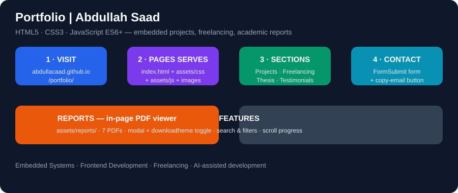

<div align="center">

# Portfolio | Abdullah Saad

**Empowering projects through freelancing expertise and AI-assisted development.**


*HTML5 · CSS3 · JavaScript ES6+ · GitHub Pages*

🌐 **Live Site:** [abdullacaad.github.io/portfolio](https://abdullacaad.github.io/portfolio/)

</div>

---

## 🎯 What this is

My personal portfolio site. I'm Abdullah Saad — an Embedded Systems enthusiast and Frontend Developer who turns hardware into sleek, interactive experiences. From gesture-controlled cars to admin dashboards, I merge logic with design.

> **The idea:** one site that shows my embedded & software projects, the freelancing services I offer, my academic work and reports, and what clients and mentors say — with a way to get in touch.

**Highlights:** Fast Delivery · Clean Architecture · AI-Enhanced Workflow

## 🖼️ Site map



📸 **Screenshots:** no screenshot file is in this repo, so no preview image is shown. A real screenshot of the live site can be added later: save it as `docs/screenshots/site.png` and it will show here. No fake screenshots are included.

## 📄 Sections

- **Home** — animated headline, intro, and highlights
- **About Me** — Embedded Systems enthusiast and Frontend Developer
- **Embedded & Software Projects** — searchable, filterable project grid
- **Freelancing Services** — academic and technical services I offer
- **Academic Portfolio** — thesis and research cards with downloadable PDF reports
- **Client & Mentor Feedback** — testimonials
- **Get In Touch** — contact form + social links

## 💻 Embedded & software projects

| Project | Stack |
|---------|-------|
| GUI-Based Scholarship Management System — desktop software for managing scholarship applications, with automated shortlisting and real-time tracking | Java Swing / JavaFX, MySQL |
| Console-Based School Management System — command-line app to manage school records with file handling and OOP | C++, File I/O, OOP |
| Arduino-Based Hand Gesture Controlled Car — gesture-driven wireless car using an accelerometer and RF modules (Microprocessor & Interfacing final project) | Arduino UNO, Embedded C, ADXL345, nRF24L01 |
| 4-Bit Binary Counter Using D Flip-Flops — digital circuit simulated in Logisim, counting 0–15 | Logisim, Digital Logic |
| Analog Multimeter Circuit — custom-built analog multimeter using an ammeter and passive components | Analog Circuit Design |
| Predictive Maintenance of Power Transformers Using Machine Learning — ML-based fault detection and failure prediction from sensor data | Python, scikit-learn, Pandas |

## 🧑‍💻 Freelancing services

- **Computing Fundamentals** — programming assignments and coursework in C, C++, Java, Python
- **LaTeX Report Writing** — academic reports, technical papers, and thesis documentation
- **Machine Learning Assignments** — classification, regression, clustering, neural networks (scikit-learn, TensorFlow, PyTorch)
- **Final Year Project (FYP)** — end-to-end FYP development with implementation and documentation
- **FYP Report & Thesis** — professional report and thesis writing
- **Arduino & Embedded Systems** — custom Arduino projects, microcontroller programming, sensor integration, IoT

## 🎓 Academic portfolio

Thesis and research cards on the site, each with a downloadable PDF report in `assets/reports/`:

| Card | Report |
|------|--------|
| Embedded Systems & IoT Implementation — Gesture-Controlled Vehicle with Real-time Monitoring | `report finale.pdf` (2024) |
| Full-Stack Web Application Development — Task Management System | `taskmanagementsystem.pdf` (2024) |
| Predictive Analytics and Model Development — Applied Data Analysis & Machine Learning | `Applied Data Analysis and Machine Learning.pdf` (2024) |
| Fault detection and failure prediction using sensor-driven ML models — Predictive Maintenance of Power Transformers Using Machine Learning | `Predictive Maintenance of Power Transformers Using Machine Learning.pdf` (2024) |
| UI/UX Design and Development Planning — Portfolio Design Proposal | `Portfolio Design Proposal.pdf` (2024) |
| Complete Implementation Guide and Specifications — Portfolio Website Documentation | `Portfolio Website Documentation.pdf` (2024) |

Outcomes stated on the site itself: 95% gesture recognition accuracy for the gesture-controlled vehicle, and 92% accuracy on the test dataset for the applied data analysis & ML work. (These are the site's own claims, quoted here as written on the site.)

## 💬 Client & mentor feedback

> "Abdullah delivered a full embedded prototype on time with very clear documentation. The quality was above our expectation for a student-led project." — **Project Supervisor, Embedded Systems Lab**

> "Great communication and clean frontend implementation. He quickly translated requirements into a polished and responsive interface." — **Freelance Client, Web Application Project**

> "From planning to deployment, he handled the project professionally. Strong problem-solving and excellent ownership throughout the lifecycle." — **Team Collaborator, Final Year Project**

## ✨ Site features

- Dark / light theme toggle
- Scroll progress bar and back-to-top button
- Project search and filters
- In-page PDF viewer (modal) with download button for the academic reports
- Contact form (via FormSubmit) with a copy-email button
- Responsive layout with a hamburger menu on small screens

## 🛠️ Tech stack

| Layer | Technology |
|-------|-----------|
| Markup | HTML5 |
| Styling | CSS3 |
| Logic | JavaScript ES6+ |
| Fonts | Space Grotesk, Sora, JetBrains Mono (Google Fonts) |
| Icons | Font Awesome 6.4.0 |
| Forms | FormSubmit |
| Hosting | GitHub Pages |

## ⚡ View / run locally

```bash
git clone https://github.com/abdullacaad/portfolio.git
cd portfolio
# Open index.html in your browser — no build step, no server needed.
# Or serve it locally (so the PDF viewer and assets resolve cleanly):
python3 -m http.server 8000
# then visit http://localhost:8000
```

## ☁️ Deploy on GitHub Pages

This repo has no deployment workflow file, so publishing is done through the Pages settings:

1. Push all files to a repo on GitHub.
2. Go to **Settings → Pages**, set the source to the `main` branch, `/ (root)`.
3. The site goes live at `https://abdullacaad.github.io/portfolio/` (verified live).

## 📂 Project layout

```
portfolio/
├── index.html                  # All sections: home, about, projects,
│                               # freelancing, thesis, testimonials, contact
├── assets/
│   ├── css/style.css           # All styling
│   ├── js/main.js              # Theme toggle, search/filter, PDF modal, nav
│   ├── images/                 # avatar.png, favicon.png, project images
│   └── reports/                # Academic PDFs (7 reports, 2024)
├── docs/architecture.svg       # Site-map diagram
└── README.md
```

## 📬 Contact

- 📧 mabdullahsaadofficial@gmail.com
- 💼 [linkedin.com/in/abdullacaad](https://www.linkedin.com/in/abdullacaad)
- 🐙 [github.com/abdullacaad](https://github.com/abdullacaad)
- 📘 [facebook.com/abdullacaad](https://facebook.com/abdullacaad)
- 📸 [instagram.com/abdullacaad](https://instagram.com/abdullacaad)

---

© 2026 Muhammad Abdullah Saad
